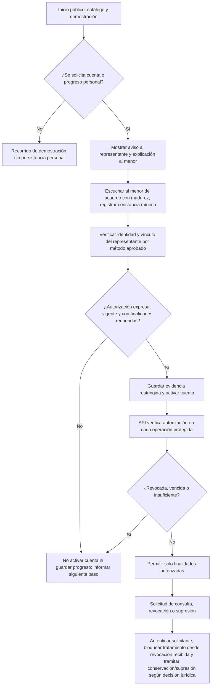

# Consentimiento para menores: diseño para revisión (Sprint 2)

**Estado:** propuesta técnica, 8 de octubre de 2026. **No implementado ni aprobado jurídicamente.** Este documento prepara [AP-304](https://juanmiguelsworkspace-40060689.atlassian.net/browse/AP-304), [AP-305](https://juanmiguelsworkspace-40060689.atlassian.net/browse/AP-305), [AP-308](https://juanmiguelsworkspace-40060689.atlassian.net/browse/AP-308) y [AP-311](https://juanmiguelsworkspace-40060689.atlassian.net/browse/AP-311). AP-304 y AP-305 están «En curso»; AP-308 y AP-311 siguen «Por hacer». La revisión jurídica/privacidad, el texto aprobado y la política de conservación son condiciones pendientes; por ello este diseño no habilita registro ni pruebas con menores reales.

## Reglas consultadas y alcance de la propuesta

| Fuente oficial | Lo que sustenta | Consecuencia propuesta |
| --- | --- | --- |
| [Ley 1581 de 2012, arts. 7, 8, 9 y 12](https://www.funcionpublica.gov.co/eva/gestornormativo/norma.php?i=49981) | Derechos prevalentes de niños, niñas y adolescentes; autorización previa e informada susceptible de consulta; información sobre finalidades y derechos. | No usar un umbral extranjero de 13 años ni activar tratamiento personal por una casilla genérica. |
| [Decreto 1377 de 2013, arts. 5, 7, 8, 9 y 12](https://www.funcionpublica.gov.co/eva/gestornormativo/norma_pdf.php?i=53646) | Finalidades específicas; medio verificable y prueba de autorización; solicitud de revocación/supresión; interés superior, derechos fundamentales, representante legal y derecho del menor a ser escuchado según madurez. | Diseñar consentimiento verificable por finalidad y una ruta para escuchar al menor y atender solicitudes. |
| [Concepto de la SIC sobre tratamiento de datos de menores](https://sedeelectronica.sic.gov.co/publicaciones/boletin-juridico/concepto/tratamiento-excepcional-y-autorizacion-del-representante-legal-con-interes-superior) | Reitera excepcionalidad, interés superior, derecho a ser escuchado y autorización del representante por medio consultable. | Someter finalidades, flujo y evidencia a revisión especializada antes del piloto. |
| [SIC: casillas premarcadas e inacción](https://sedeelectronica.sic.gov.co/publicaciones/boletin-juridico/boletin/el-silencio-las-casillas-premarcadas-por-defecto-y-la-inaccion-no-constituyen-el-consentimiento-conforme-con) | Una casilla o aceptación de política, por sí sola, puede ser insuficiente; importan identidad, información, expresión y prueba. | Exigir acción afirmativa no premarcada **más** comprobación del representante; conservar evidencia protegida. |

Estas fuentes sirven para preparar el diseño, no sustituyen el dictamen del profesional responsable. En particular, el artículo 9 del Decreto 1377 contempla excepciones para supresión/revocación cuando exista deber legal o contractual de permanecer en la base; cualquier conservación residual necesita fundamento y plazo revisados, no una regla inventada por el equipo.

## Finalidades y datos mínimos propuestos

**Finalidad esencial candidata:** crear y proteger una cuenta educativa, guardar progreso entre sesiones y permitir el ejercicio de derechos sobre esos datos. Cada finalidad que implique tratamiento distinto —analítica identificable, comunicaciones, uso de respuestas para entrenar modelos o compartir datos con terceros— exige evaluación separada y no se incluye por defecto. El diagnóstico de demostración sin cuenta ni progreso persistente debe permanecer separado del recorrido personal.

| Momento | Datos candidatos | Regla de minimización |
| --- | --- | --- |
| Antes de autorizar | Selección de grado/tema sin identificar al estudiante; token aleatorio de trámite con expiración. Si hace falta contactar al representante, obtener su contacto desde una pantalla dirigida a esa persona, con información sobre el tratamiento de **sus propios datos**. | No pedir nombre, documento, correo, respuestas ni progreso del menor durante una solicitud no autorizada; no almacenar borradores de registro rechazados. La base para tratar contacto del representante se decide jurídicamente. |
| Verificación del representante | Identificador interno, canal de contacto verificado y resultado del método aprobado para comprobar identidad/vínculo. | No guardar foto del documento, biometría ni documento completo salvo necesidad justificada y aprobada. La recepción de un código por correo, por sí sola, no demuestra el vínculo legal. |
| Autorización vigente | ID de estudiante y representante, versión/hash del aviso, finalidades autorizadas, instante UTC, medio, referencia de evidencia y estado. | Evidencia cifrada y separada; acceso por rol, auditado. La opinión del menor requiere un mecanismo comprensible y la mínima constancia que la asesoría autorice, sin publicar sus palabras. |
| Cuenta y estudio | Identificador seudónimo, grado elegido, tema, resultados mínimos del diagnóstico y progreso acordado. | Restringir acceso por propietario; no persistir respuestas completas si bastan resultados agregados. Definir antes de implementar AP-257/AP-236. |

## Flujo propuesto



La comprobación de la API precede tanto a la activación como a **cada** escritura/lectura de progreso personal. Si la verificación está caída o el estado no es concluyente, se bloquea la operación protegida. Una petición directa a la API debe pasar por el mismo control que la interfaz.

## Contrato técnico preliminar (sin endpoints implementados)

No son rutas existentes; son invariantes que deben mantenerse al elegir backend y almacenamiento.

```ts
type ConsentStatus = "pending" | "active" | "revoked" | "expired" | "rejected";

type ConsentRecord = {
  id: string;                    // aleatorio, sin datos personales
  studentId: string;             // solo después de autorización válida
  representativeId: string;      // vínculo verificado por método aprobado
  status: ConsentStatus;
  purposes: string[];            // códigos versionados, sin consentimiento implícito
  noticeVersion: string;
  noticeDigest: string;
  grantedAt: string | null;      // UTC
  revokedAt: string | null;      // UTC
  verificationMethod: string;    // código del método, no el secreto usado
  evidenceRef: string | null;    // depósito de acceso restringido
};
```

**Transiciones:** `pending → active` solamente después de verificar representante, vínculo, información, acción expresa, derecho del menor a ser escuchado y finalidades; `pending → rejected/expired`; `active → revoked/expired`. No reactivar `revoked` cambiando una marca: se necesita un nuevo acto y una nueva evidencia. Definir expiración y necesidad de nueva autorización por cambio de finalidades o aviso con asesoría.

**Puerta de autorización:** para `POST /account/activate` y cualquier ruta que lea o persista progreso, el servidor valida sesión, vínculo con `studentId`, `status=active`, finalidades requeridas y vigencia en la misma operación transaccional que la escritura. Rechazo propuesto: `403 CONSENT_REQUIRED` o `403 CONSENT_REVOKED`, con mensaje público sin revelar existencia de otra cuenta o identidad; un `401` corresponde a sesión ausente. No poner datos capturados en URL, logs, trazas, métricas ni respuesta de error. La revocación invalida sesiones y tokens de acceso a operaciones protegidas; las lecturas posteriores también se bloquean. El control de carrera debe impedir que una escritura confirmada después de revocar se acepte con un estado leído antes de revocar.

**Consulta y revocación:** canal autenticado para representante/titular legitimado, constancia de solicitud y respuesta, revisión de excepciones de conservación y supresión según la política aprobada. La solicitud de revocación no equivale automáticamente a borrar toda evidencia: separar bloqueo inmediato de operaciones de la decisión documentada sobre qué prueba debe conservarse y por cuánto tiempo.

## Amenazas y pruebas con datos sintéticos

| Caso | Ataque o entrada sintética | Resultado esperado antes de considerar implementación terminada |
| --- | --- | --- |
| Autorización válida | Representante y vínculo verificados; finalidades necesarias; aviso versionado; acción afirmativa. | Se crea una única evidencia y solo entonces se activa la cuenta y se escribe progreso. |
| Ausente o parcial | `pending`, sin evidencia o falta la finalidad `progress_storage`. | Respuesta controlada; cero cuenta activa y cero fila de progreso; no se retiene el cuerpo rechazado. |
| Revocada o vencida | Revocar durante sesión abierta y luego pedir lectura/escritura. | Bloqueo del servidor, token/sesión protegido invalidado y ninguna escritura nueva. |
| Bypass de interfaz | Llamar directamente API con `studentId` inventado o ajeno, sin pasar por pantalla. | `401/403`; ninguna revelación de identidad, evidencia ni progreso. |
| Suplantación de representante | Capturar enlace/código de correo, repetirlo, abrirlo desde otra cuenta. | Enlace de un solo uso y duración limitada; el código no sustituye verificación de vínculo legal. |
| Doble envío/carrera | Dos clics para autorizar; escritura de progreso simultánea a revocación. | Una sola concesión idempotente; orden transaccional consistente; revocación gana para operaciones posteriores. |
| Acceso a evidencia | Estudiante, otro representante o administrador sin rol autorizado consulta `evidenceRef`. | Denegado y auditado; contenido cifrado sin exposición en logs. |
| Intento rechazado | Enviar nombre/documento/respuestas de menor cuando falta autorización. | Rechazo y descarte; ninguna persistencia personal fuera del mínimo de seguridad definido y aprobado. |

Las pruebas son **criterios por construir**, no resultados ejecutados. Usar únicamente perfiles ficticios y verificar tanto almacenamiento como respuestas HTTP y registros de observabilidad.

## Decisiones y entregables pendientes

| Decisión / evidencia | Responsable sugerido | Bloquea |
| --- | --- | --- |
| Identificar responsable y encargados del tratamiento, política, finalidades legítimas y evaluación de interés superior. | Titular del proyecto + asesoría jurídica/privacidad. | Aviso y piloto real. |
| Aprobar aviso para representante y versión comprensible para el menor; método para escuchar y documentar su opinión. | Asesoría jurídica + pedagogía. | AP-305 y publicación. |
| Aprobar método verificable de identidad y vínculo legal; resolver representante en casos especiales. | Asesoría jurídica + producto/seguridad. | AP-308. |
| Definir base y retención del contacto del representante durante la invitación; plazos de expiración, retención de evidencia, atención de derechos y excepciones a supresión. | Asesoría jurídica/privacidad. | Persistencia y revocación. |
| Elegir backend, base de datos, cifrado, roles y auditoría; implementar la puerta del servidor y pruebas anteriores. | Desarrollo + revisión de seguridad. | AP-308, AP-311, cuentas reales. |

**Criterio de cierre por incidencia:** AP-305 requiere flujo, **aviso aprobado**, decisión de retención, artefacto implementado y pruebas del caso principal y límite; AP-308 requiere persistencia/verificación implementadas con pruebas; AP-311 requiere bloqueo de API probado incluso ante bypass y revocación; AP-304 requiere el recorrido completo y revisión especializada antes de publicación. Este documento aporta diseño y casos de prueba, pero no satisface por sí solo esos cierres.
